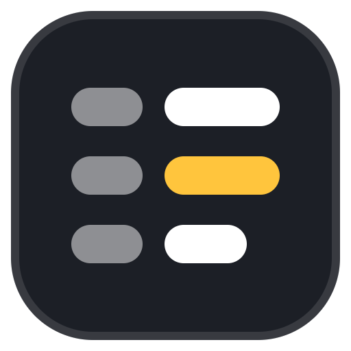
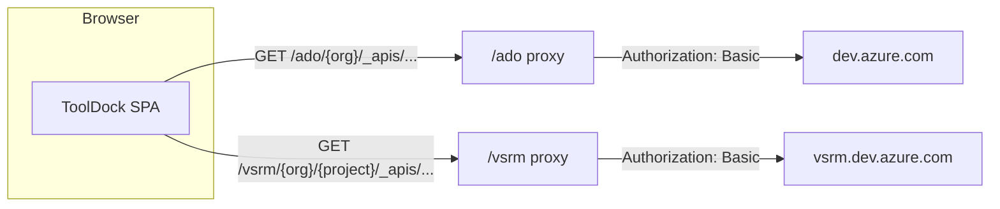

<p align="center">
  
</p>

# ToolDock

**ToolDock is a browser-only toolkit for Azure DevOps engineers who manage variable groups, App Service settings, and release pipeline variables - fourteen focused tools instead of the portal plus a spreadsheet plus copy-paste.**


No backend. No database. No telemetry. Enter your organization and a Personal Access Token, pick a project, and work. Two tools require no account at all.



## Features

| Tool                              | What it does                                                                                                                            | Needs connection | Writes |
| --------------------------------- | --------------------------------------------------------------------------------------------------------------------------------------- | ---------------- | ------ |
| **Variable Search**               | Finds a key or value across every variable group in the project, with highlighted matches; exports results to CSV                       | Yes              |        |
| **Generate App Service Settings** | Builds the `-KEY "$(KEY)"` argument string from one or more variable groups, one line or one per line                                   | Yes              |        |
| **Compare vs App Settings**       | Diffs variable groups against pasted App Settings - matched / missing / extra / duplicate buckets, searchable, with a TXT or CSV report | Yes              |        |
| **Variable Group Diff**           | Compares two variable groups key by key - changed, missing, and secret values marked; exports to XLSX; links to Copy Missing Keys       | Yes              |        |
| **Multi-Group Compare**           | Compares 2–8 groups side by side - conflicts and missing keys surface across all environments at once; exports to XLSX                  | Yes              |        |
| **Copy Missing Keys**             | Adds the keys one group has and another lacks, after a per-key review; never changes existing variables; secrets can be added empty     | Yes              | Yes    |
| **CSV Import**                    | Imports `Key,Value` rows into a variable group; shows a full per-key overwrite/new/same plan and requires confirmation before writing   | Yes              | Yes    |
| **Copy Group to Project**         | Creates a copy of a variable group in another project (or this one under a new name); secrets are added empty or left out               | Yes              | Yes    |
| **Export Variable Group**         | Exports one group as CSV, JSON, TXT, or XLSX; JSON matches the Azure DevOps variables shape                                             | Yes              |        |
| **Export All Variable Groups**    | Exports selected groups into one multi-sheet XLSX workbook, one sheet per group                                                         | Yes              |        |
| **Export Release Variables**      | Exports a release pipeline's inline variables - definition-level or a single stage - as CSV, JSON, TXT, or XLSX                         | Yes              |        |
| **Release Pipeline Mapping**      | Shows which release pipelines and stages consume each variable group; exports the full cross-reference to XLSX                          | Yes              |        |
| **Duplicate Finder**              | Finds duplicate keys in pasted App Settings, with line numbers and source highlighted                                                   | No               |        |
| **Sort App Settings**             | Sorts pasted App Settings alphabetically, with duplicates removed                                                                       | No               |        |

Three tools write to Azure DevOps: Copy Missing Keys, CSV Import, and Copy Group to Project. Each shows exactly what will change and asks for confirmation first. Everything else reads.

Secret values can't be read from Azure DevOps, so exports keep secret, empty, and missing apart everywhere:

- **XLSX:** `[secret]`, `[empty]`, and `[not set]` placeholders in gray italic, with navy header rows and color-coded status rows.
- **CSV:** a `Secret` column (`yes`) is added when a group has secrets; their values are left blank. CSV Import skips such rows so re-importing an export never wipes a real secret.
- **TXT:** secrets are written as commented-out lines; **JSON:** `"isSecret": true`.

## Migrate

The **Tools | Migrate** switch in the header opens Migrate mode: guided migrations from one Azure DevOps project or organization to another, or from Jira Cloud into Azure Boards. Use the same organization and token on both sides to move between projects. Migration screens need a screen at least 1024 px wide.

> **Full guide: [MIGRATION.md](MIGRATION.md)**. Every screen and field of each migration explained with examples, token scopes per side, the lock timer, resuming, the report, a recommended order for a full project move, and troubleshooting.

| Migration           | Copies                                                                                                             | Doesn't copy (listed in the report)                                                                                                               |
| ------------------- | ------------------------------------------------------------------------------------------------------------------ | ------------------------------------------------------------------------------------------------------------------------------------------------- |
| **Variable groups** | Groups and variables; secrets created empty (or left out); merge into same-named groups optional                   | Secret values, Key Vault-linked groups (shown disabled), permissions                                                                              |
| **Repos**           | Every branch, tag and commit (Azure DevOps' own import service), branch policies (optional)                        | Pull requests, Git LFS objects, permissions, forks; build-validation and reviewer policies                                                        |
| **Pipelines**       | YAML and classic builds, classic releases, task groups; pools, connections, groups and repos mapped                | Secret variables and connection credentials, run history, approvals and environment checks; steps from missing extensions are skipped or disabled |
| **Boards**          | Work items with mapped types, states and fields, area/iteration paths, attachments, inline images, comments, links | Revision history, boards/queries/dashboards, assignments unless user mapping is on                                                                |
| **Jira to Boards**  | Issues, sprints (as iterations), labels and components (as tags), attachments, comments, links                     | Workflows, automation, worklogs, watchers; assignments unless user mapping is on                                                                  |

Every migration follows the same steps: connect both sides, choose what to copy, map, review what won't be copied, run, then a **Migration report**. The report is a checklist of everything left for you to do (fill a secret, create a service connection, install an extension...), each item linked to the exact page in the target. It downloads as Excel, Markdown or CSV.

- **Resumable:** progress and source-to-target ID maps are kept in IndexedDB for 30 days (never tokens). Re-running a job, or **Retry failed**, skips everything already copied. Earlier jobs are listed on the Migrate overview.
- **Rate limits:** requests honour Azure DevOps' `Retry-After` and `X-RateLimit-*` headers and back off on `429`. Writes are never retried after a network error, since they may have landed.
- **Boards process changes:** when the target uses an inherited process, missing types, states and fields can be created in it. A built-in process (Agile, Scrum, Basic, CMMI) can only be mapped to.
- **Repo imports** use a temporary service connection in the target that holds the source token; Azure DevOps deletes it when the import finishes and ToolDock deletes it if the import fails.

Token scopes per side (each connection card lists them too): the **source** token can be read-only. The **target** needs write scopes for what you migrate, e.g. Variable Groups (Read, create & manage), Code (Read, write & manage) plus Service Connections (Read, query & manage) for repos, Build (Read & execute) / Release (Read, write, execute & manage) / Task Groups (Read, create & manage) / Environment (Read & manage) for pipelines, Work Items (Read, write & manage) for Boards and Jira. Keeping the original created date needs the "Bypass rules on work item updates" permission; without it items are created today and the original date is noted. Jira uses an Atlassian account email and API token, read-only.

## Quick start

```bash
cd ui
npm install
npm run dev
```

Open [http://localhost:5173](http://localhost:5173). Click any Azure DevOps tool to open the inline connect form, enter your **organization** and **PAT**, and select a project.

PAT scopes required (Azure DevOps → User settings → Personal access tokens):

| Scope                                    | Why                                                                                                | Required |
| ---------------------------------------- | -------------------------------------------------------------------------------------------------- | -------- |
| Variable Groups → Read, create, & manage | Read variable groups; needed to write with Copy Missing Keys, CSV Import and Copy Group to Project | Yes      |
| Project and Team → Read                  | List projects in your organization                                                                 | Yes      |
| Release → Read                           | Read release pipeline definitions                                                                  | Optional |

Grant the Release scope only if you use the two Release Pipelines tools. A read-only Variable Groups scope covers eleven of the fourteen tools; the three that write need Read, create, & manage.

## How it works

Azure DevOps sends no CORS headers, so the browser cannot call it directly. ToolDock requests same-origin relative paths that a proxy forwards to the correct upstream. There are two upstreams because release definitions live on a separate subdomain:

| Path                  | Upstream                              | Used by                               |
| --------------------- | ------------------------------------- | ------------------------------------- |
| `/ado/*`              | `https://dev.azure.com`               | Projects, variable groups, migrations |
| `/vsrm/*`             | `https://vsrm.dev.azure.com`          | Release pipeline definitions          |
| `/jira/{site}/rest/*` | `https://{site}.atlassian.net/rest/*` | Jira to Boards (read-only)            |

Every request carries `Authorization: Basic base64(":" + PAT)`.

Connection is gated at the route level. Clicking a gated tool with no active session renders the connect form inline in the same layout - the URL does not change, the sidebar stays visible. Once the PAT is validated against the projects list, the session activates and the tool renders automatically. Each connected tool additionally requires a selected project, enforced by a separate `RequireProject` guard.

## Security model

**By default the PAT lives only in memory.** The Zustand session store has no `persist` middleware - no `localStorage`, no `sessionStorage`, no cookies. Refreshing the page clears the session.

**Staying signed in is opt-in and encrypted.** The lock button in the header encrypts the PAT with AES-GCM-256 under a **non-extractable** `CryptoKey` and stores the ciphertext in IndexedDB for a rolling 30-minute window. The plaintext never touches disk. On next load the app decrypts before React mounts and renders as connected.

Migrate mode keeps its source and target connections separately from the Tools-mode PAT, in memory only, and each can be locked the same way (its own vault slot and key). The lock button shows the time left: green, amber from 10 minutes, red with a countdown from 5 minutes, with alerts and an **Extend** action at 5 minutes and 1 minute.

Key limitations of the vault:

- The 30-minute window is sliding - every successful restore resets it, so refreshing keeps the PAT on disk indefinitely.
- The vault defends against disk inspection, not against same-origin script. An XSS on your deployment is full PAT exposure.
- The organization name is stored in cleartext. The selected project is never persisted.
- On a shared machine, opting in means the next person to open the browser is connected as you.

Proxy notes:

- `Authorization: Basic` is encoding, not encryption. Verify that your deployment's access logs and WAF rules do not capture request headers - [nginx.conf.example](ui/nginx.conf.example) calls this out inline.
- **Security headers** ([vercel.json](ui/vercel.json), [netlify.toml](ui/netlify.toml), [nginx.conf.example](ui/nginx.conf.example)): a strict Content-Security-Policy (`connect-src 'self'`, so page script can only talk to this site's proxy; scripts only from this site plus the hashed inline theme script), `frame-ancestors 'none'`, `Referrer-Policy: no-referrer`, `nosniff`, HSTS and a locked-down `Permissions-Policy`. If you edit the inline script in `index.html`, update the hash; `npm test` fails when they don't match. `npm run preview` serves the same headers locally.
- The proxy paths (`/ado/*`, `/vsrm/*`, `/jira/*`) are protected by [Vercel Edge Middleware](ui/middleware.ts): `GET` and `PUT` are forwarded; every `POST`, `PATCH` and `DELETE` must match one exact endpoint the app uses (creating groups, repos, imports, temporary service connections, pipelines, work items, attachments, comments, area/iteration paths...), everything else gets `405`. `/jira/{site}` only reaches `{site}.atlassian.net`, only for `GET` plus the issue search, and forwards only the headers Jira needs. Requests whose `Origin` or `Referer` header does not match the app's domain are rejected with `403`. Set the `ALLOWED_ORIGIN` environment variable in your Vercel dashboard to your live domain (e.g. `https://tooldock.notbatman.me`) to activate the origin check - without it the check is skipped (safe for local dev). `VERCEL_URL` (injected automatically by Vercel) additionally covers the `.vercel.app` deployment URL so both domains work without extra config.
- The proxy still forwards any valid PAT supplied by the caller. HTTPS-only deployment and keeping the domain off shared infrastructure remain important.

## Scripts

Run from `ui/`:

| Script              | What it does                                                              |
| ------------------- | ------------------------------------------------------------------------- |
| `npm run dev`       | Dev server (port 5173) with `/ado` and `/vsrm` proxies                    |
| `npm run build`     | `tsc -b` then production build → `dist/`                                  |
| `npm run preview`   | Serve the production build locally                                        |
| `npm run typecheck` | `tsc --noEmit`                                                            |
| `npm run lint`      | ESLint with `--max-warnings 0`                                            |
| `npm run format`    | Prettier on `src/**/*.{ts,tsx,css}`                                       |
| `npm test`          | Vitest unit tests (tools, migrations, proxy allow-list, security headers) |
| `npm run contrast`  | Checks theme text contrast (WCAG 2 + APCA)                                |

## Deploy

Build the static assets then serve `dist/` with proxy rules ahead of the SPA fallback. If the rewrites come after the fallback, requests resolve to `index.html` and the app reports that Azure DevOps did not return JSON.

```bash
cd ui && npm run build
```

| Platform | Config                                                               | Notes                                                                  |
| -------- | -------------------------------------------------------------------- | ---------------------------------------------------------------------- |
| Vercel   | [ui/vercel.json](ui/vercel.json) + [middleware.ts](ui/middleware.ts) | Full support: method/path allow-list and the Jira proxy                |
| Netlify  | [ui/netlify.toml](ui/netlify.toml)                                   | No Jira proxy and no method filtering (the token's scopes still apply) |
| nginx    | [ui/nginx.conf.example](ui/nginx.conf.example)                       | Jira proxy included; no Azure DevOps method filtering by default       |

Jira Data Center/Server on a private network can't be reached from a hosted deployment; run ToolDock yourself inside that network for it. Before releasing, run `npm audit` from `ui/` and review the result.

Point the host's root directory at `ui/`. One environment variable to set on your host:

| Variable         | Value                     | Purpose                                              |
| ---------------- | ------------------------- | ---------------------------------------------------- |
| `ALLOWED_ORIGIN` | `https://your-domain.com` | Activates the proxy origin check (Vercel middleware) |

Organization and PAT are entered in the UI at runtime - no other env vars needed.

## Tech stack

| Layer            | Choice                                                                                           |
| ---------------- | ------------------------------------------------------------------------------------------------ |
| UI               | React 18, TypeScript 5 (strict), Vite 6                                                          |
| Routing and data | React Router 6, TanStack Query 5                                                                 |
| State            | Zustand 5 (in-memory); optional AES-GCM vault in IndexedDB                                       |
| Styling          | Tailwind CSS 3 with a token-based design system (Graphite), Radix primitives, Lucide, Sonner     |
| Spreadsheets     | ExcelJS (browser bundle via Vite alias) - full cell styling: fills, fonts, borders, merged cells |

## Project structure

```text
ToolDock/
├── README.md                  ← this file
└── ui/
    ├── README.md              ← contributor guide
    ├── vite.config.ts         ← /ado + /vsrm dev proxies
    ├── vercel.json
    ├── netlify.toml
    ├── nginx.conf.example
    └── src/
        ├── router.tsx         ← routes generated from the tool registry
        ├── features/
        │   ├── home/          ← landing page, tool grid
        │   ├── connection/    ← inline connect form
        │   └── tools/         ← registry.ts + one directory per tool
        ├── lib/
        │   ├── api/           ← client, auth header, errors, per-resource modules
        │   ├── hooks/         ← TanStack Query hooks
        │   └── utils/         ← patVault, csv, xlsx, groupDiff, groupCompare, appSettings, theme
        ├── store/             ← sessionStore (PAT, org, project)
        ├── types/             ← ado.ts, tools.ts
        └── components/        ← layout, common components, shadcn/ui primitives
```

## Extending

The sidebar, home page, and routes are generated from [`ui/src/features/tools/registry.ts`](ui/src/features/tools/registry.ts). Adding a tool is two steps:

1. Create `ui/src/features/tools/<your-tool>/YourTool.tsx`.
2. Append one `ToolDefinition` to `TOOLS` - `id`, `title`, `description`, `icon`, `group`, `path`, `component`, `requiresConnection`.

No router or sidebar edits needed. See [ui/README.md](ui/README.md) for the full contributor workflow.

## FAQ

**Why does it need a proxy?** Azure DevOps sends no CORS headers, so a browser cannot call `dev.azure.com` directly. All requests go to a same-origin path that a rewrite forwards.

**Is my PAT stored on disk?** Not unless you click the lock button. With the lock enabled it is stored AES-GCM-256 encrypted in IndexedDB for a rolling 30 minutes; the plaintext never hits disk. Without it, a refresh wipes the session.

**Does refreshing keep me connected?** Only with the lock enabled and within the 30-minute window. The selected project is never restored - you re-pick it each session.

**Do all tools need a connection?** No. Duplicate Finder and Sort App Settings work on pasted text with no account. The other nine need an organization, a PAT, and a selected project.

**Why do the Release Pipelines tools fail when the rest work?** They require the optional Release (Read) PAT scope and the `/vsrm` proxy rule. If your deployment predates that rule, add it.

## Contributing

Issues and merge requests welcome at [github.com/nishantxrana/tooldock](https://github.com/nishantxrana/tooldock). Run `npm run typecheck` and `npm run lint` from `ui/` before opening one. When a change touches the tool registry, API versions in `constants.ts`, or PAT storage, update both this file and [ui/README.md](ui/README.md) in the same merge request - those three facts drift fastest.

## License

License TBD - this repository has no `LICENSE` file, so usage rights are granted by default.
